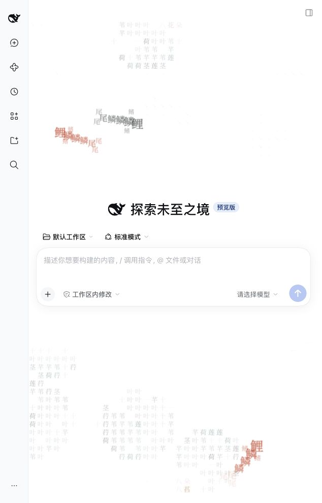

# Inkpond for DSH

[简体中文](README.md)

Interactive Chinese glyph ink-wash backgrounds for DeepSeek Harness.
The default **lotus pond** has drifting koi, lotus leaves and flowers. Pointer movement makes ripples;
clicking empty space drops ink. Misty hills and a Qingming handscroll are also included.



## Compatibility

The initial verified host is **DSH 0.2.1-rc.3**, using the kernel shipped with the official macOS
Desktop app in an isolated Web profile. `engines.dsh` is intentionally pinned to that version.
Other releases and Windows/Linux are not yet verified. The adapter uses semantic conversation DOM
markers; host layout/API changes need validation before widening compatibility.

## Install

Download `dsh-inkpond-0.1.0.tgz` from [Releases](https://github.com/shin4/inkpond-dsh/releases),
then install the local package through the host plugin manager, or into a regular Web profile:

```bash
dsh plugin --profile web add /absolute/path/to/dsh-inkpond-0.1.0.tgz
```

Refresh the page; restart the instance if it does not hot-load. Desktop users should use the app's
installation UI or its actual profile, which is not necessarily `web`. The tarball is prebuilt and
does not compile code at installation time.

Alternatively, install the published version from [npm](https://www.npmjs.com/package/dsh-inkpond):

```bash
dsh plugin --profile web add dsh-inkpond@0.1.0
```

A GitHub source checkout requires `npm ci && npm run build` before installation.

## Preferences

Open Plugins → Installed → dsh-inkpond. Select Lotus pond (default), Misty hills or Qingming handscroll;
choose new conversations only (default) or all conversations, toggle color accents, adjust ink strength,
and select system animation preferences or a still image. All-conversation mode needs further long-chat testing.
Restore defaults returns to Lotus pond, 45% strength, new conversations only and system motion preferences.

The canvas passes through clicks and never controls typing or sending. Hidden pages pause animation;
reduced motion produces a still image, and forced colors hides the decoration. Weak devices downgrade automatically.

Preferences use this client's origin-local storage (`dsh-inkpond.preferences.v1`); performance uses
`dsh-inkpond.tier.v1`. They do not synchronize between browsers, ports or devices. When storage is
unavailable, changes last only for the current page. Uninstall removes runtime instances, styles and DOM
markers but retains preferences for reinstall. Delete those two storage keys to remove preferences too.

## Development

Node.js 22+ and npm:

```bash
npm ci
npm run check
npm pack
```

`check` runs type checking, tests and the build. The tarball contains the Host entry, DSH client factory,
offline fonts and licenses. React comes from DSH; the renderer is pinned to `inkpond@0.1.0`.
Test tarballs in a separate `DSH_HOME`. Avoid uninstall tests in a daily profile. DSH local-link removal
was observed cleaning the linked target's development dependencies, so use tarballs for acceptance testing.
See the [verification record](docs/verification.md) and [release checklist](docs/release.md).

## Scope and licenses

This plugin adds only backgrounds and appearance preferences. It registers no model tools, reads no
messages, sends no telemetry and makes no third-party network requests. All fonts are included; no CDN
is needed. The host's own networking is outside this plugin's control.

MIT code; renderer from [inkpond](https://github.com/shin4/inkpond). Font subsets use SIL OFL 1.1;
see [third-party notices](THIRD_PARTY_NOTICES.md). Independent community project, unaffiliated with DeepSeek.
