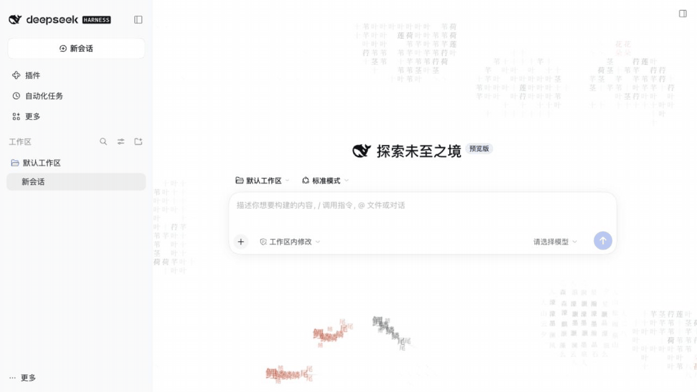

# Inkpond for DSH

[简体中文](README.md)

Interactive Chinese glyph ink-wash backgrounds for DeepSeek Harness.
The default **Big fat whale** swims through glyph waves, eats rice, spouts grains and reacts to the pointer.
Lotus pond, Misty hills, a Qingming handscroll, the 24 solar terms and the Northern sea are also included.



[View the 16:9 still screenshot](https://raw.githubusercontent.com/shin4/inkpond-dsh/main/docs/images/lotus-preview.png) · Actual capture, approximately 10 seconds, with the lotus scene and 45% strength (not the current default).

## Compatibility

Installation requires **DSH >=0.2.1-rc.3**, with no upper bound, so later prereleases and
stable releases are not rejected by an exact version pin. Actually tested hosts are
**0.2.1-rc.3 and 0.2.1-rc.5** on macOS in isolated Web profiles for backgrounds.
The update entry was also tested in isolated **0.2.2-alpha.2**; this prerelease is
a capability test host, not an installation requirement. Other versions and Windows/Linux remain unverified. Installation eligibility does not imply verified compatibility.
The adapter uses semantic conversation DOM markers and leaves unknown layouts untouched;
host API/layout changes may still require updates.

## Plugin updates (0.3.3)

The settings page provides a manual update entry. When the Host exposes native `listVersions` / `updateBundle`, Check for updates finds an eligible stable version and shows the installed and target versions. After confirmation, DSH installs that exact version and reports completion, a required restart, or recovery.
No automatic checks or silent upgrades run. Leaving the page cancels its check; self-update may reload settings, so confirm the final version in native Plugins.

Hosts such as DSH rc.5 show manual update instructions and Open Plugins. Tarball, Git and linked installations fall back to native management according to Host support. Appearance preferences are retained.
The Client only calls Host update APIs; it does not contact npm, download packages or uninstall itself. A failed check is never reported as up to date.

This entry is available from **0.3.3**. See the [release record](docs/release.md) for publication status.

## Repository link (0.3.4)

The settings footer adds “GitHub · Enjoy Inkpond? Give it a ⭐”, opening this plugin's repository in a new page when clicked.
This is a regular link: it does not automatically request GitHub or read or change Star status.
**0.3.4 is published on npm and GitHub Releases**; see the [release record](docs/release.md).

## Install

**0.3.4** adds the settings repository link. DSH >=0.2.1-rc.3 and the Big fat whale default are unchanged.
Install 0.3.4 using the instructions below.

### Desktop or Web: use the Add plugin wizard (recommended)

1. Open **Plugins → Add plugin → Install a third-party plugin** in DSH.
2. Enter the npm package name in the **Package name or address** field:

   ```text
   dsh-inkpond
   ```

   To pin this version, enter `dsh-inkpond@0.3.4`.
3. Select **Official npm registry** under the installation registry options, then click **Install**.
   Mirrors may not have synchronized a newly published version yet.
4. Start a new empty conversation to see Big fat whale on a fresh install; existing saved scene choices are preserved. If DSH requests a restart,
   fully quit and reopen the application.

pnpm 11 defaults to avoiding versions published less than 24 hours ago. On release day, a bare package name can select an older version even from the official registry; enter `dsh-inkpond@0.3.4` explicitly.

The wizard installs directly from npm, independently of listings in 1024 Store or dshmarket.
No source checkout or local compilation is needed. The compatibility limits above still apply.

### Install into a Web profile with the CLI

```bash
dsh plugin --profile web add dsh-inkpond@0.3.4
```

For Desktop, prefer the in-app wizard above, which targets the current application's profile.
The terminal's `web` profile is not necessarily the Desktop profile.
The package is published on [npm](https://www.npmjs.com/package/dsh-inkpond).

### Install a Release tarball

Download `dsh-inkpond-0.3.4.tgz` from [Releases](https://github.com/shin4/inkpond-dsh/releases/tag/v0.3.4).
Enter its absolute local path in the host plugin manager, or install into a regular Web profile:

```bash
dsh plugin --profile web add /absolute/path/to/dsh-inkpond-0.3.4.tgz
```

When upgrading from 0.1.0, follow the host prompt to uninstall the old plugin, then install the 0.3.4 tarball. Appearance preferences are retained.
Refresh the page; restart the instance if it does not hot-load. The tarball is prebuilt and
does not compile code at installation time.
A GitHub source checkout requires `npm ci && npm run build` before installation.

## Preferences

The following describes 0.3.4. Existing saved scene choices are preserved; clients without saved preferences and Restore defaults use Big fat whale.

Open Plugins → Installed → dsh-inkpond. Select Lotus pond, Misty hills, Qingming handscroll, 24 solar terms (selected by the current date), Northern sea (waves and a whale) or Big fat whale (default; eating rice, spouting grains and reacting to the pointer);
choose new conversations only (default) or all conversations, toggle color accents, adjust ink strength,
and select system animation preferences or a still image. All-conversation mode needs further long-chat testing.
Restore defaults returns to Big fat whale, 45% strength, new conversations only and system motion preferences.

The canvas passes through clicks and never controls typing or sending. Hidden pages pause animation;
reduced motion produces a still image, and forced colors hides the decoration. Weak devices downgrade automatically.

Preferences use this client's origin-local storage (`dsh-inkpond.preferences.v1`); performance uses
`dsh-inkpond.tier.v1`. They do not synchronize between browsers, ports or devices. When storage is
unavailable, changes last only for the current page. Uninstall removes runtime instances, styles and DOM
markers but retains preferences for reinstall. Delete those two storage keys to remove preferences too.

## Development

Node.js 22+ and npm:

```bash
npm ci
npm run check
npm pack
```

`check` runs type checking, tests and the build. The tarball contains the Host entry, DSH client factory,
offline fonts and licenses. React comes from DSH; the renderer is pinned to local inkpond commit `4cb32fb1ef9120d4115e47265ad13a13c7fb59f6`
(an independent dependency tarball; see `vendor/README.md`).
Test tarballs in a separate `DSH_HOME`. Avoid uninstall tests in a daily profile. DSH local-link removal
was observed cleaning the linked target's development dependencies, so use tarballs for acceptance testing.
See the [verification record](docs/verification.md) and [release checklist](docs/release.md).

## Scope and licenses

This plugin provides backgrounds, appearance preferences and a Host update entry. It registers no model tools,
reads no messages and sends no telemetry. The Client does not contact external services directly;
when the user checks or confirms an update, the DSH Host contacts the package registry and performs installation. All fonts are included; no CDN
is needed. The host's own networking is outside this plugin's control.

MIT code; renderer from [inkpond](https://github.com/shin4/inkpond). Font subsets use SIL OFL 1.1;
see [third-party notices](THIRD_PARTY_NOTICES.md). Independent community project, unaffiliated with DeepSeek.
