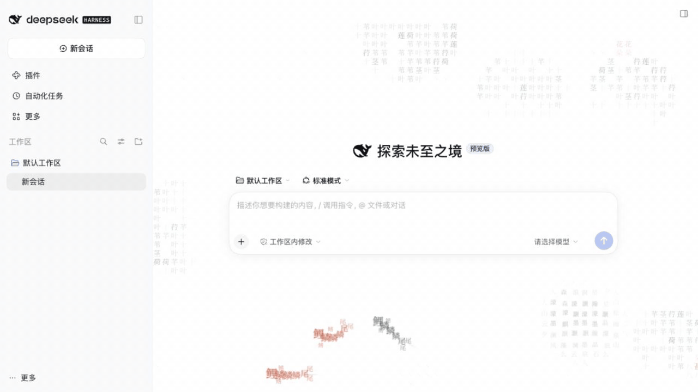

# 墨池 · Inkpond for DSH

[English](README.en.md)

以字为墨，以页为池。为 DeepSeek Harness 会话界面铺一层可交互的汉字水墨背景。

默认是**大肥鲸**：圆滚滚的鲸鱼在汉字海浪中游动，会游向饭碗吃饭、喷米，并响应指针互动。
可切换莲池、山水、清明上河、二十四节气和北冥，保留输入区留白、明暗主题跟随及自动性能降级。



[查看 16:9 静态截图](https://raw.githubusercontent.com/shin4/inkpond-dsh/main/docs/images/lotus-preview.png) · 实际录屏，约 10 秒，莲池场景与 45% 浓度（非当前默认场景）。

## 兼容性

安装要求为 **DSH >=0.2.1-rc.3**，不设上限，后续 rc 和正式版不会因精确版本锁定而被拒绝。
背景功能已实测 **0.2.1-rc.3 和 0.2.1-rc.5**（macOS，隔离 Web profile）。
更新入口另在 **0.2.2-alpha.2** 隔离宿主验收；该预发布版本只用于能力验证，并非安装要求。其他版本及 Windows/Linux 尚未验证。
允许安装不等于已验证兼容。插件依赖会话容器的语义 DOM 标记；未知布局不会挂载背景，宿主 API 或布局变更仍可能需要适配。

## 插件更新（0.3.3）

设置页提供手动更新入口。支持宿主原生 `listVersions` / `updateBundle` 时，点击“检查更新”查找可用的稳定版本，显示当前与目标版本；确认后由 DSH 安装明确版本，并显示完成、重启或恢复结果。
不会自动检查或静默升级。检查请求在页面卸载时取消；自更新可能重新载入设置页，请在原生插件管理中确认最终版本。

DSH rc.5 等不支持这些接口的宿主显示手动更新说明和“打开插件管理”入口；从本地安装包、Git 或链接安装的插件按宿主能力降级为原生管理。外观偏好保留。
客户端只调用宿主更新接口，不直接访问 npm、不自行下载或卸载。检查失败不会显示为“已是最新”。

此入口从 **0.3.3** 提供。发布状态见 [发布记录](docs/release.md)。

## 仓库入口（0.3.4）

设置页底部新增「GitHub · 喜欢墨池？点个 ⭐」，点击后在新页面打开本插件仓库。
该入口只是普通链接，不自动请求 GitHub，也不读取或修改 Star 状态。
**0.3.4 已发布至 npm 和 GitHub Releases**，详见 [发布记录](docs/release.md)。

## 安装

**0.3.4** 新增设置页仓库链接；兼容性要求仍为 DSH >=0.2.1-rc.3，默认大肥鲸。
可按下方方式安装 0.3.4。

### 桌面版或网页版：通过添加插件向导安装（推荐）

1. 打开 DSH 的 **插件 → 添加插件 → 安装第三方插件**（Add plugin）。
2. 在向导的「包名或地址」输入框中填写 npm 包名：

   ```text
   dsh-inkpond
   ```

   如需固定版本，填写 `dsh-inkpond@0.3.4`。
3. 在「安装源」中选择 **npm 官方源**，点击 **安装**（Install）。新版本可能尚未同步到镜像源。
4. 安装后新建空白会话，首次安装即可看到默认大肥鲸；已有保存偏好的客户端会保留原选择。若宿主提示重启，请完全退出并重新打开 DSH。

pnpm 11 默认避开发布未满 24 小时的版本。新版本发布当天，即使选择官方源，裸包名也可能选回旧版；请显式填写 `dsh-inkpond@0.3.4`。

此入口直接从 npm 安装，不依赖 1024 Store 或 dshmarket 是否已收录。
无需下载源码或在本机编译。适用版本仍以本文的兼容性说明为准。

### 使用 CLI 安装到 Web profile

```bash
dsh plugin --profile web add dsh-inkpond@0.3.4
```

桌面版推荐使用上述应用内向导，它会安装到当前应用的 profile；
不要假定终端的 `web` profile 就是桌面配置。包发布于 [npm](https://www.npmjs.com/package/dsh-inkpond)。

### 使用 Release 安装包

从 [GitHub Releases](https://github.com/shin4/inkpond-dsh/releases/tag/v0.3.4) 下载 `dsh-inkpond-0.3.4.tgz`。
在 DSH 插件管理页填入本地安装包的绝对路径，或使用普通 Web profile：

```bash
dsh plugin --profile web add /absolute/path/to/dsh-inkpond-0.3.4.tgz
```

从 0.1.0 升级时，按宿主提示先卸载旧插件，再安装 0.3.4 安装包。外观偏好会保留。
刷新页面；若宿主未热加载，重启对应实例。安装包包含构建产物，不执行安装期编译。
GitHub 源码 checkout 需要先 `npm ci && npm run build`，不能直接从未构建源码安装。

## 使用

插件 → 已安装 → dsh-inkpond（以下为 0.3.4 行为）：

已有客户端保存的场景选择会保留；无保存偏好的客户端和“恢复默认”使用大肥鲸。

- 默认大肥鲸，亦可选莲池、山水、清明上河、二十四节气和北冥。节气随当前日期选择画面；北冥呈现海浪与鲸影；大肥鲸会游向饭碗吃饭、喷米，并响应指针互动。
- 默认仅新会话显示；可选择所有会话（长对话兼容性仍需更多实测）。
- 调整淡彩、墨色浓淡，选择跟随系统动画或静态画面。
- 恢复默认会回到大肥鲸、45% 浓度、仅新会话、跟随系统动画。

画布不会接管点击、键盘或发送消息。关闭标签页显示会暂停，减少动画设置会生成静态画面，
高对比度模式会隐藏画布。弱设备会自动降低动画档位。

外观偏好存于当前客户端 origin 的 `localStorage`（`dsh-inkpond.preferences.v1`），
性能档位使用 `dsh-inkpond.tier.v1`。它们不跨浏览器、端口或设备同步。
存储不可用时设置仅在当前页面有效。卸载会清除运行实例、样式与 DOM 标记，保留本地偏好便于重装；
需要彻底清除偏好时可删除上述两个站点存储键。

## 开发

Node.js 22+，npm：

```bash
npm ci
npm run check
npm pack
```

`check` 执行类型检查、单元测试和构建。`npm pack` 生成独立安装包，包含 Host 入口、
DSH 客户端工厂、内嵌字体和许可证。React 由宿主提供，绘制引擎固定使用 本地 inkpond 提交 `4cb32fb1ef9120d4115e47265ad13a13c7fb59f6`（独立依赖包，详见 `vendor/README.md`）。

使用独立 `DSH_HOME` 验证安装包；不要在日常 profile 中进行卸载测试。
已观察到 DSH 本地链接卸载可能清理链接目标的开发依赖，因此推荐始终用 `.tgz` 做安装验收。

详见 [验证记录](docs/verification.md) 和 [发布清单](docs/release.md)。

## 范围与许可

本插件提供背景、外观设置和宿主更新入口，不注册模型工具，不读取消息或发送遥测。
客户端不直接访问外部服务；用户触发更新检查或升级时，由 DSH 宿主访问包源并执行安装。
六个字体子集随包提供，无需 CDN。宿主自身的网络行为不由本插件控制。

代码采用 MIT；绘制核心来自 [inkpond](https://github.com/shin4/inkpond)，
字体采用 SIL OFL 1.1，见 [第三方声明](THIRD_PARTY_NOTICES.md)。
独立社区插件，与 DeepSeek 官方无隶属关系。
